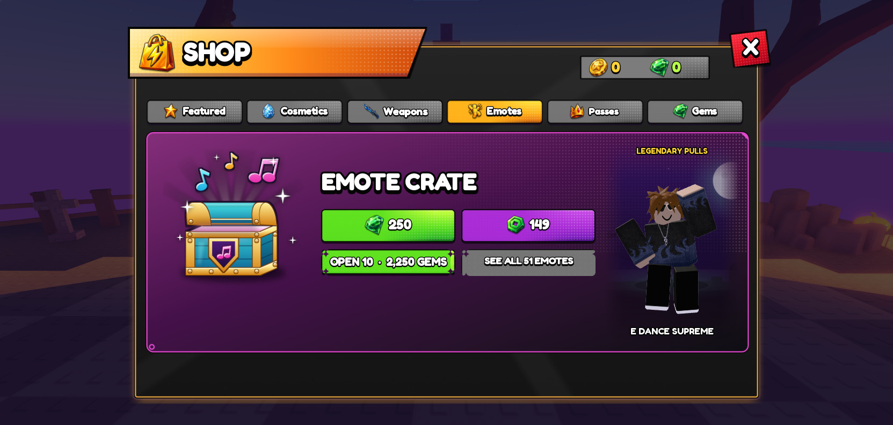

# HOS-ICON-001: Emote Crate icon

**v2, 18 Oct (Matthew: "We also need to make this look better. Use html to create this crate in 3d. then we can just get an image icon of it as well"):** the icon is now a render of a real 3D chest.
- `tools/build/HOS-ICON-001/emote_crate_3d.html` builds it in three.js. It has:
  - rounded teal planks, and a barrel lid opened on its back hinge with a hot pink glow pouring out;
  - metallic gold bands and rivets under a studio reflection map;
  - an extruded gold shield with a purple field and a pink double note.
- HTML/SVG on top of the render adds the light rays, the dark outline (stacked CSS drop-shadows), and the notes and sparkles.
- `render.mjs` screenshots it in the pre-installed headless Chromium (software WebGL) at 2×, and it's scaled to 512 × 512. To render again: `npm i three@0.169.0 playwright-core@1.56.1` anywhere, then `NODE_MODULES=<that>/node_modules node tools/build/HOS-ICON-001/render.mjs`.
- To look at it: open the html (with a `vendor/` folder holding three.js) and add `?orbit&preview` to drag the camera round.
- The first, flat version is kept as `emote_crate_icon_v1.png`, which is the one uploaded as `78853379381316`.

The same day, the Shop's Emote Crate card lost its text clutter (Matthew: "We don't need all that text clutter on the emote crate menu"). The odds rows, the subtitle and the pity / duplicates line are gone. The title and buttons now sit in one stack beside the crate:

The odds are still on the Emotes screen's crate page, where players go to see what's inside.

**Round 3 (Matthew: "put the obj of the crate in github, but fix the z fighting on it first. We also got too much dead space now… make the see all 51 emotes button more attractive… gray signifies deactivated/locked"):**
- **Z-fighting fixed.**
  - The lid's gold end bands were closed half-cylinders whose flat caps sat exactly on the barrel's caps, which made streaks. They're now open half-tubes reaching .03 past the barrel ends, each closed by a half ring.
  - The inside glow is lifted clear of the body top and the rim band, which also shared a plane.
- **The model is in the repo** as `docs/HOS-ICON-001/model/`:
  - `EmoteCrate.obj` and `.mtl`: 31 named parts (`Planks_0`, `Gold_3`, `LidBand_1`…) and 7 materials.
  - `EmoteCrate.glb`: the same, with the plank and glow textures.
  - The model is about 2.8 × 2.7 × 1.9 units, with the lid open as in the icon.
  - It's exported from the same page (`EXPORT=1 … render.mjs`).
- **The card:** a bigger crate (440), a 1.3× title, and the buttons centred down the card beside it.
- **SEE ALL 51 EMOTES** is now the Shop's bright orange (the active-tab art) with an eye icon, so it reads as something to press rather than locked.

Matthew: "Generate a 2d icon for the emote crate. Rn it's the default crate icon. Take inspiration from our other icon styles." Then: "fit the tune note inside the purple. so make it smaller."

## What it is
`docs/HOS-ICON-001/emote_crate_icon.png` is 512 × 512 with a transparent background. It's in the same family as the Weapon Crate and Dual Wield chest icons:
- a chunky 3/4-view chest with gold corner bands, top and bottom bands, rivets and a dark outline
- an open lid with light pouring out
- an emblem shield on the front

To make it read as the emote one, it has:
- a teal body
- a glossy pink double music note on the shield, sized to sit inside the purple
- cyan, pink and gold notes and white sparkles bursting from the lid

It's drawn by `tools/build/HOS-ICON-001_emote_crate_icon.py`, which builds a small 3D box-and-lid model in Python (PIL) at 4× and scales it down. No image model was used. Run it again to change anything: colours, how far the lid is open, or the size of the notes.

## Where it goes (once uploaded)
Today the emote crate shows the generic gift icon (`rbxassetid://87833590533916`) here:
- `EOSUI.Root.Shop…PageEmotes.CrateCard.CrateArt` (+ `CrateArtShadow`)
- `EOSUI.Root.Emotes…CratePage.Detail.CrateIcon` (+ `CrateIconShadow`)

The gift icon is also used elsewhere (the daily gift and other cards), so only the emote crate's images change.

## Uploaded and wired (18 Oct)
Matthew uploaded it as `rbxassetid://78853379381316`. It's now used in three places:
- **Shop, Emotes page:** the crate card (`CrateArt` and its shadow).
- **Emotes screen, Crate page:** the crate icon (`CrateIcon` and its shadow).
- **CrateShowcase:** the glowing crate over a player's head while they open an Emote Crate. Other players see it too. It was the gift icon before.

The gift icon stays everywhere else, such as the daily gift and reward toasts.
- I checked in Matthew's playtest that the image downloads (in 1.4 s), and it showed on both cards.
- The changed lines and old ids are in `docs/backups/HOS-ICON-001_2026-10-18/changes.md`. The full old `CrateShowcase` is in Studio under `ServerStorage._Backups.HOS-ICON-001_2026-10-18`.
- **If EOSUI is ever rebuilt** from `ServerStorage.EOSUIBuild`, the two cards go back to the gift icon, because the build data still says gift. Set them again, or change the build data.
