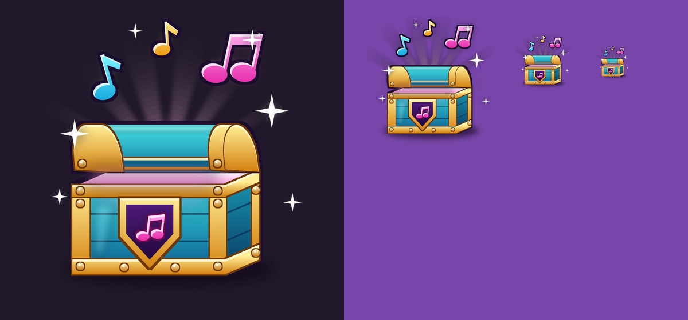

# HOS-ICON-001: Emote Crate icon

Matthew: "Generate a 2d icon for the emote crate. Rn it's the default crate icon. Take inspiration from our other icon styles." Then: "fit the tune note inside the purple. so make it smaller."

## What it is
`docs/HOS-ICON-001/emote_crate_icon.png` is 512 × 512 with a transparent background. It's in the same family as the Weapon Crate and Dual Wield chest icons:
- a chunky 3/4-view chest with gold corner bands, top and bottom bands, rivets and a dark outline
- an open lid with light pouring out
- an emblem shield on the front

To make it read as the emote one, it has:
- a teal body
- a glossy pink double music note on the shield, sized to sit inside the purple
- cyan, pink and gold notes and white sparkles bursting from the lid

It's drawn by `tools/build/HOS-ICON-001_emote_crate_icon.py`, which builds a small 3D box-and-lid model in Python (PIL) at 4× and scales it down. No image model was used. Run it again to change anything: colours, how far the lid is open, or the size of the notes.

## Where it goes (once uploaded)
Today the emote crate shows the generic gift icon (`rbxassetid://87833590533916`) here:
- `EOSUI.Root.Shop…PageEmotes.CrateCard.CrateArt` (+ `CrateArtShadow`)
- `EOSUI.Root.Emotes…CratePage.Detail.CrateIcon` (+ `CrateIconShadow`)

The gift icon is also used elsewhere (the daily gift and other cards), so only the emote crate's images change.

## Uploaded and wired (18 Oct)
Matthew uploaded it as `rbxassetid://78853379381316`. It's now used in three places:
- **Shop, Emotes page:** the crate card (`CrateArt` and its shadow).
- **Emotes screen, Crate page:** the crate icon (`CrateIcon` and its shadow).
- **CrateShowcase:** the glowing crate over a player's head while they open an Emote Crate. Other players see it too. It was the gift icon before.

The gift icon stays everywhere else, such as the daily gift and reward toasts.
- I checked in Matthew's playtest that the image downloads (in 1.4 s), and it showed on both cards.
- The changed lines and old ids are in `docs/backups/HOS-ICON-001_2026-10-18/changes.md`. The full old `CrateShowcase` is in Studio under `ServerStorage._Backups.HOS-ICON-001_2026-10-18`.
- **If EOSUI is ever rebuilt** from `ServerStorage.EOSUIBuild`, the two cards go back to the gift icon, because the build data still says gift. Set them again, or change the build data.
