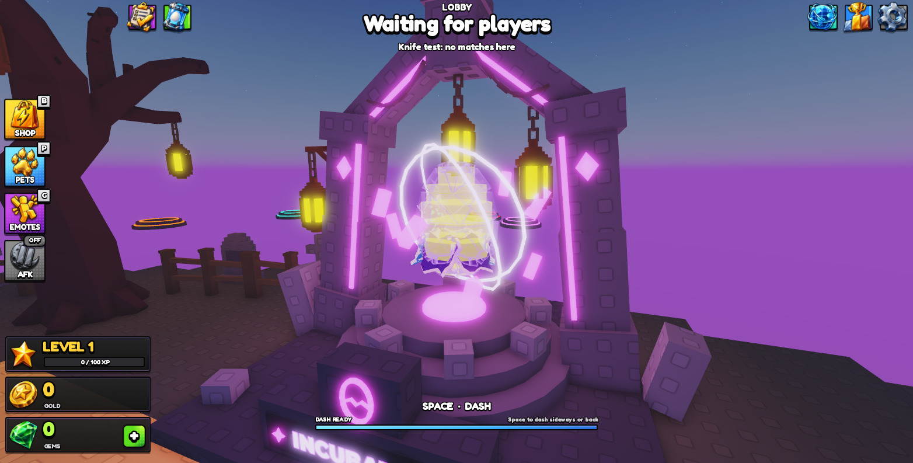
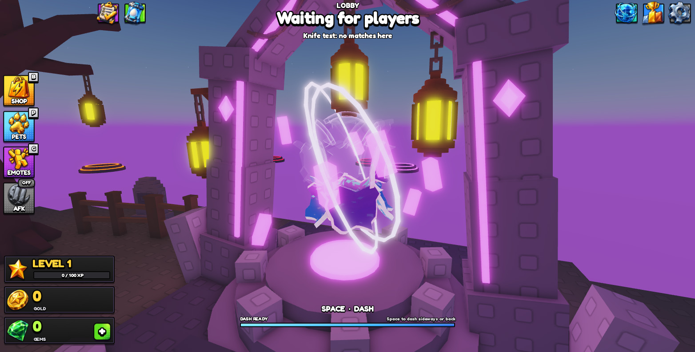

# HOS-INC-001: Animated incubator with a puzzle egg

The lobby incubator (`Workspace.Incubator.Incubator`) is now animated and wired into the egg and shard system. Walking up opens the incubator screen. Each player sees their own egg, built from cracked-shell puzzle pieces as their fill goes up, over a hologram of the finished egg.

## What players see
- **Idle animation** (client only; the server's parts never move):
  - The egg turns and bobs.
  - The orbit ring turns the other way.
  - The floating crystals circle, bob and spin.
  - The lanterns sway on their chains.
  - The neon strips, beams, runes, sign and lights breathe.
- **Walk-up:** stepping within 11 studs of the egg opens the incubator screen (`EggUIController`'s `openIncubator`), and walking past 14 studs closes it. It only closes a screen the walk-up opened, and it never opens during a match.
- **Your egg:**
  - The egg is cut along jagged crack lines into 18 pieces that fit together: a bottom cap, rings of 5, 6 and 5 pieces, and a top cap.
  - Pieces are placed bottom up, one per 1/18 of fill. Each piece wears the rarity of the shard that filled it, using the same texture atlas as the egg shards (`EggShardKit` `SA_<rarity>`).
  - Every piece that isn't placed yet shows as a ForceField hologram of its own curved mesh. An empty egg is a whole hologram egg with the crack lines showing, and it fills in solid piece by piece.
  - A full egg is solid and glows gold.
- **Shards flying in:** shards earned since the last visit fly from the player's back to the egg one by one when they walk up. As each one lands, its pieces appear just outside the egg and snap into place, with a pulse and a sound. After that the server's list of unseen shards is cleared.
- **Hatch:** the pieces burst outward, tumbling and fading, and the next egg starts.

## Files
| Where | What |
|---|---|
| `StarterPlayerScripts.EOS.Controllers.IncubatorWorld` (new) | All of the above, client side |
| `…IncubatorWorld.EggPieces` (new) | The puzzle generator: crack layout, curved shell pieces with thickness and rims, UVs on the shard atlas; builds the egg from the baked meshes, or from wedge parts as a fallback |
| `ServerStorage.EOSBuild.BakeIncubatorEgg` (new) | `obj()` exports the pieces as an OBJ; `adopt(model)` takes the imported meshes into `ReplicatedStorage.IncubatorEggPieces` |
| `EggUIController` | One line in `init` starts `IncubatorWorld` |
| `IncubatorLogic` | `incubator.unseen` (each settled shard's rarity, capped at 12), `markSeen`, and `view` includes `unseen`. Hatching clears it. |
| `EggService` | New `EOS_Egg.SeenShards` remote (1 s cooldown) calling `IncubatorLogic.markSeen` |
| `EggTests.ProfileIncubatorSpec` | 3 tests for the unseen list |
| `docs/HOS-INC-001/IncubatorEggPieces.glb` | The 18 pieces, ready for Studio's 3D Importer (made from the `.obj` by `tools/build/HOS-INC-001_obj2glb.py`; the importer merges an OBJ's objects into one mesh, so use the `.glb`) |

The Incubator model's `ModelStreamingMode` is `Atomic`, so the client gets it whole.

## The baked egg pieces (done 17 Oct)
The game builds each piece from a baked mesh. A plugin can't upload meshes yet ("CreateAssetAsync … not available yet"), and Studio's importer merges an OBJ's objects into one mesh. So the pieces went through the 3D Importer as `docs/HOS-INC-001/IncubatorEggPieces.glb`, which keeps one node per piece:
- Matthew imported the file with creator **Eggs with Friends**.
- `BakeIncubatorEgg.adopt` moved the 18 MeshParts into `ReplicatedStorage.IncubatorEggPieces` (Piece1–Piece18, attributes `Centre` / `Mid`), and the sizes matched the generator.
- Mesh ids, Piece1 to Piece18: 84269797617090, 88118522965095, 122256290543998, 120066833790496, 127530689738706, 120913288208629, 74531545298493, 113063044109553, 77904836546807, 121436036274647, 107033692907946, 125280533840727, 89072925326374, 109207612983235, 88905020084450, 80226418040872, 73834036291579, 128125464800223.

**If the shape ever changes** (the tuning values below), re-export and re-import:
1. Save `BakeIncubatorEgg.obj()` to the `.obj`.
2. Run `tools/build/HOS-INC-001_obj2glb.py <obj> <glb>`.
3. Import the `.glb` and run `adopt`.

Without the folder, the egg falls back to wedge parts in flat rarity colours.

## Checks (Studio playtests)
- **Fill 11/18:** pieces 1–11 show and the rest are hidden.
- **Walk-up:** the fly-in played, the screen opened, and the server's unseen list was cleared.
- **Ready egg:** 18/18 pieces, hologram fully transparent, gold glow.
- **Hatch:** a pet was granted, every piece part was thrown more than 3 studs out mid-burst, then 0 pieces showed and the hologram came back.
- **No errors** from IncubatorWorld in the logs.
- **Mesh pieces:** checked in edit mode, both whole and half built, and in game after the import: 18 baked MeshParts with rarity textures, 7 of 18 shown at fill 7, all 18 when ready, all 18 thrown out by the hatch.
- **Hologram:** at fill 7, 7 pieces are solid and 11 are hologram. A full egg is 18 solid and 0 hologram. After a hatch, 0 are solid and 18 are hologram again.
- **EggTests:** 75 passed, 0 failed. G04 and E03 also print FAIL lines; they did before this ticket too (old pieces path).

## Old egg removed (17 Oct, Matthew: "we just need a curved hologram mesh and the new fragments")
- **Removed:** the model's faceted egg shell `A09_EggShards` (160 parts, the first hologram) and its neon core `A09_EggCore` (6 discs).
- **Backups:** the originals are in `ServerStorage._Backups.HOS-INC-001_2026-10-17_IncubatorOldEgg`, and a part dump is in `docs/backups/HOS-INC-001_2026-10-17/`.
- **New marker:** `A09_EggCentre`, an invisible part at the old core's centre (−51.30, 16.31, 1494.97). The client places the egg on it.
- **Hologram:** a ForceField copy of each piece mesh, 1% larger, in light lavender (225, 175, 255). It fades out as its piece snaps in and comes back after a hatch.

## Notes
- **Why the pieces are baked:** building the pieces at runtime with EditableMesh worked in Studio, but a player's client ran out of its EditableMesh memory budget after 8 of the 18 pieces, and phones get less. Baked meshes have no such limit and don't need the "Allow Mesh / Image APIs" setting.
- **The egg HTML** lives on Hunter's PC and isn't in the repo, so the look follows the in-game `EggShardKit` shards and their texture atlas (`HOS-INC-001/shard_atlas_samples.png`: common, rare, epic, legendary).
- **Hunter's egg system:** the `unseen` list is the only change. The pre-edit scripts are in `docs/backups/HOS-INC-001_2026-10-17/`.
- **Tuning** (top of `EggPieces`): egg size `H`/`R`, shell thickness `TH`, crack width `GAP`, crack rings `RINGS`, pieces per ring `BANDS`. Changing any of these means re-exporting and re-importing the OBJ.
