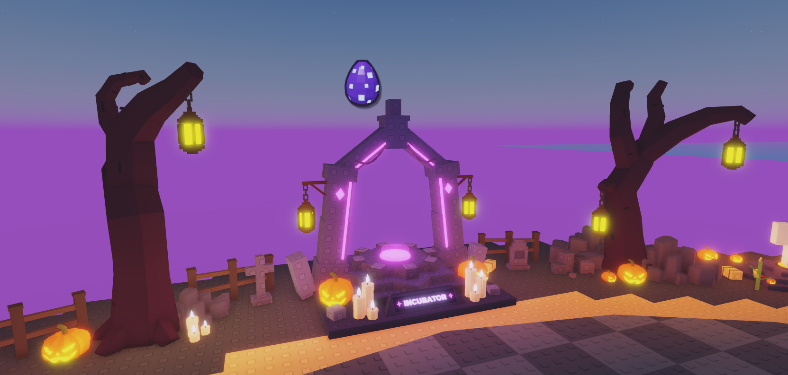

# HOS-INC-002: Egg sign over the incubator

Matthew: "put an egg sign above the incubator that's camera facing", then "Use the cosmic egg image".

## What's in Studio
- `Workspace.Incubator.Incubator.A09_EggSign` is an invisible anchored part (no collision, query or touch). It sits 3.1 studs above the top of the arch's spire, at (-51.44, 27.77, 1502.96).
- Its `EggSign` BillboardGui always turns to face the camera:
  - It's 4.2 × 4.2 studs, so it shrinks with distance like the rest of the world.
  - LightInfluence 0, so it stays bright at night. MaxDistance 250.
- `Icon` shows the cosmic egg image `rbxassetid://93711113567520`, the `I_egg_cosmic` icon from the incubator's odds panel (`StarterGui.EggUI…Panel.Odds`).
- `IconShadow` is the same image in black at 55% transparency, offset a little down-right. That's how the HUD icons do their shadow.
- No scripts were changed. These are two undo steps in Studio: "HOS-INC-002: egg sign over the incubator" and "HOS-INC-002: cosmic egg sign".
