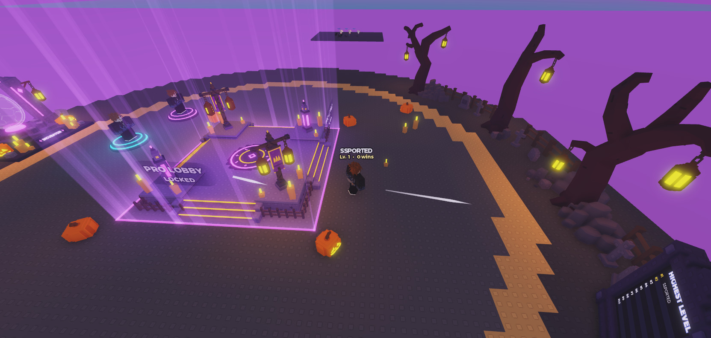

# HOS-LOBBY-004: Lobby ambience (swinging lanterns, wind) and lobby animations off in matches

Matthew: "add the lantern swinging to all lanterns ... have them animate when they get closer to it, like half the lobby distance. And then when they're playing in the field, have the lantern and other lobby animations stop completely ... not taxing when it's not even in frame. Also add some floating wind effects that are white trails ... (also keep optimized)", then "don't have the head of the wind be a flat face, also dense it less".

## What it does (client only, nothing replicates)
- **Lanterns:** every hanging lantern swings gently from the top of its chain. That covers any model with an `A03_Chain` child: the 14 on the trees and the 4 on the altar lamp posts. The incubator's two lanterns already swing in IncubatorWorld.
  - A lantern only moves while you're within **60 studs** of it (half the lobby's width) **and** it's on screen.
  - Visibility is checked 5 times a second, and motion runs at most 30 times a second, using one `BulkMoveTo` for all lanterns.
  - Lanterns that stream in later join automatically, and ones that stream out are dropped.
- **Wind:** 4 thin white wisps drift and curl through the air in front of you, and about half of them loop once.
  - They come from a fixed pool of 4 invisible movers, each with a `Trail`, under the camera. They're recycled; no new parts are made.
  - Each wisp is pointed at its head and tapers behind, with a 1.5 to 4.5 s gap before it comes back.
  - They only spawn over the island, and they're off when reduce effects is on.
- **Stopping:** everything lobby-side stops completely while you're **in a match** (`EOS_InMatch`) or the camera is **away from the lobby** (more than 40 studs past the island's edge, for example spectating). The lanterns go back to rest and the wind switches off. This covers:
  - the new lanterns and wind
  - the incubator's animation
  - the leaderboards turning to face you (FacePlayer)
  - the pro gate's fade (ProximityFade)
  - the weapon pedestals' combo loop (WeaponPedestals)
- **Incubator:** its idle animation now runs only within 60 studs and while the incubator is on screen (before, it ran within 260 studs, on screen or not). The walk-up, fly-in and hatch work as before.

## Files
| Script | Change |
|---|---|
| `Controllers.LobbyGate` (new) | `active()`, `near(pos, range)`, `onScreen(pos, r)`, `ANIM_RANGE` = 60, and the lobby's centre, radius and floor (from `Workspace.Ground.Ground_Outer`) |
| `Controllers.LobbyAmbience` (new) | Lanterns and wind. Booted from `ClientMain` (one line). |
| `Controllers.IncubatorWorld` | Gated with LobbyGate: active, within 60 studs, on screen |
| `Controllers.FacePlayer`, `Controllers.ProximityFade` | `step` returns early when `LobbyGate.active()` is false |
| `Controllers.WeaponPedestals` (HOS-WEP-001, Hunter's) | Its Heartbeat loop returns early when `LobbyGate.active()` is false (two lines; the file keeps its Windows line endings) |
| `ClientMain` | Added `require(Controllers.LobbyAmbience).init()` |

Pre-edit copies are in `docs/backups/HOS-LOBBY-004_2026-10-18/`. ClientMain and WeaponPedestals were taken from Studio, because they had changed since the last snapshot.

## Checks (Studio playtest)
- **Near:** the nearest tree lantern (24 studs) swung, 0.14 studs in 0.6 s.
- **Far:** the farthest lantern (87 studs, off screen) didn't move.
- **Off screen:** with the camera turned away from the nearest lantern it stopped, and when the camera turned back it swung again.
- **Wind:** 4 movers, wisps visible and pointed, about 2 on screen at a time.
- **In a match (`EOS_InMatch` set):** lanterns 0 movement, 0 trails on, the incubator's egg 0 movement. All of it resumed after the attribute was cleared.
- **Errors:** none from the new or changed scripts.

## Tuning
- **`LobbyAmbience`:** `SWING` (radians), `LANTERN_HZ`, `WIND_COUNT`, `WIND_DIR`, `WIND_LIFE`, the trail's look in `makeGust`, and the respawn gap in `windStep`.
- **`LobbyGate`:** `ANIM_RANGE` and `AWAY`.
