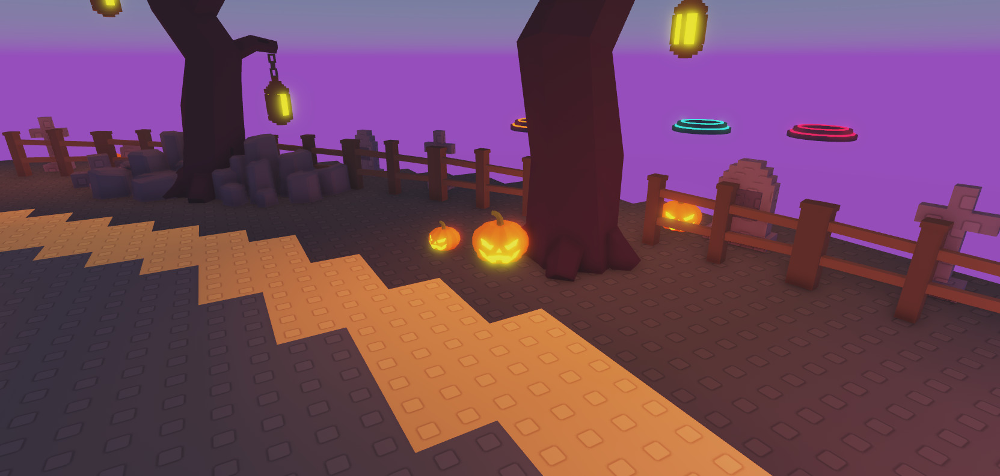
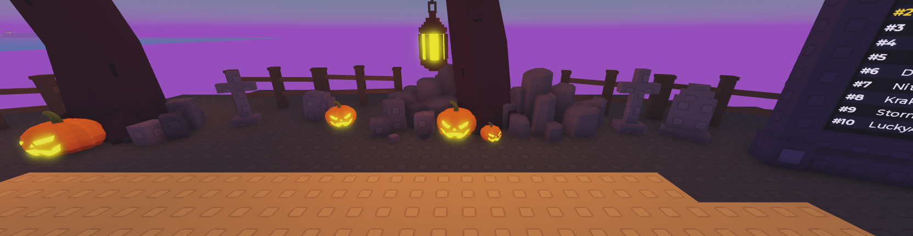
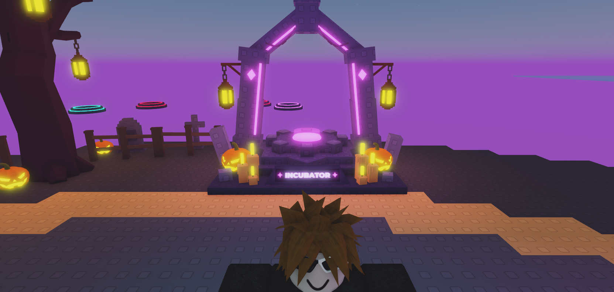

# HOS-LOBBY-005: Low-poly jack-o'-lanterns

Matthew, with a reference of a faceted low-poly jack-o'-lantern: "Redo the pumpkin to look like this, shouldn't be just block". Then: "Subtly put this around the lobby where the trees and graves are. Let's have a warm point lighting to it, but not too large and bright. Subtle orange", and "You can remove the rim from them".

## The pumpkin
- A real mesh instead of ~60 blocks: 10 ribbed lobes with flat faceted shading, a glowing carved face (angled eyes, triangle nose, jagged grin with two fangs and a square tooth) and a curved stem. Generated by `tools/build/HOS-LOBBY-005_jack_o_lantern.py` (`docs/HOS-LOBBY-005/JackOLantern.glb`, preview `JackOLantern_preview.png`). Matthew imported it with File → Import 3D; the mesh asset is 96124739533958.
- Three MeshParts: `JackBody` (orange, SmoothPlastic, the only one that collides), `JackGlow` (Neon), `JackStem` (green). The GLB also has a dark rim round the face (`JackRim`). Matthew asked for it to go, so the adopt script leaves it out.
- `A04_Light_OPTIONAL`: a warm orange PointLight (colour 255,132,44, no shadows) sitting low in front of the face, so it pools on the ground and lights up the nearby graves and fences.
  - The light is range 8, brightness 2.
  - The first setting (range 6, brightness 0.45, inside the pumpkin) didn't show against the lobby's bright ambient light ("not seeing any difference"). Range 5 at 1.5 barely showed either, and range 9 at 2.2 turned the whole graveyard orange.
  - Every pumpkin's light keeps range 8 whatever the pumpkin's size. `ScaleTo` would shrink it, so both scripts reset it after scaling.
- Kit copy: `ServerStorage.HalloweenLobbyKit.A04_JackOLantern`, 2.88 studs tall (the old kit pumpkin's height) at scale factor 1, face along -Z, pivot at the centre. The altar rebuild (`tools/build/HOS-LOBBY-002_pro_altar.lua`) and the incubator dais rebuild (`tools/build/HOS-INC-001_pedestal.lua`) pick it up with no changes, because they turn pumpkins by their Neon parts.

## Where
- **Swapped:** the 7 block pumpkins in the lobby: the 4 at the altar corners, the 2 on the incubator dais and `FloorProps.Prop_Pumpkin`. Each kept its name, parent, height, ground and facing.
- **New:** `Workspace.LobbyPumpkins`, 15 pumpkins round the graveyard edge.
  - A pumpkin at the foot of each tree on the plaza side, except Tree_02, where the rocks leave no room.
  - A tiny one beside every other tree.
  - One beside each of Grave_02, 05, 08, 12 and 15.
  - Heights are 1.1 to 2.3 studs, and faces turn roughly towards the plaza.
  - The tiny ones have no light, so there are 18 pumpkin lights in the lobby in all.
  - Rebuild with `tools/build/HOS-LOBBY-005_graveyard_pumpkins.lua`: it clears the folder and places the same spots again (fixed seed). It nudges each pumpkin sideways off anything solid. Tree hulls are ignored because they're much wider than the trunks.

## Backups
`ServerStorage._Backups.HOS-LOBBY-005_2026-10-18_BlockJackOLanterns` holds the 7 old block pumpkins and the old kit pumpkin (`Kit_A04_JackOLantern`). Each old pumpkin has a `HOS_WasAt` attribute with its old path. No scripts were changed.

## Not done
The Haunted Graveyard arena map (`_MapPreview.Preview_Graveyard`, `ServerStorage.EOS_Maps.Arena_Graveyard`) still has its own ~30 block pumpkins.
