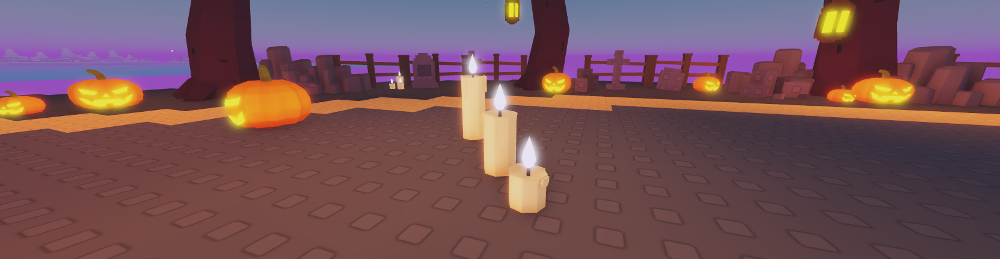
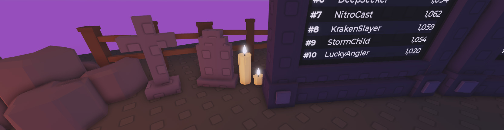
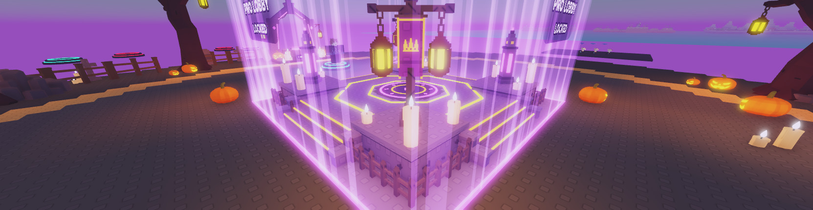
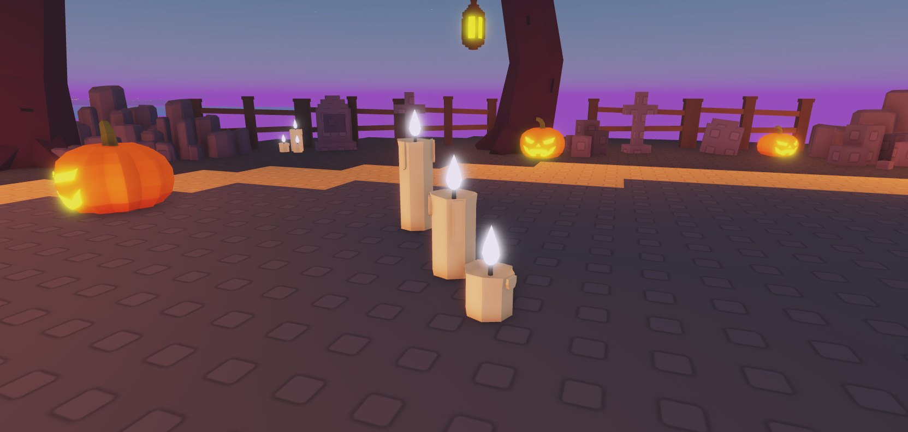
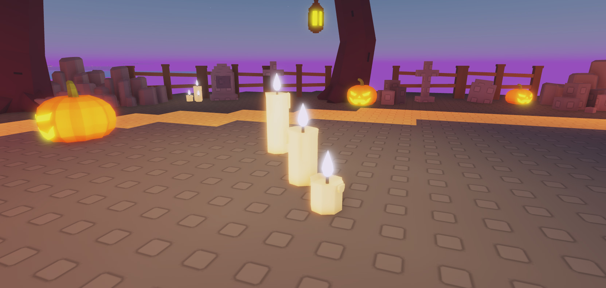

# HOS-LOBBY-006: Low-poly candles

Matthew, with a screenshot of the block candles: "do the same things for the candles, maybe make them a light color neon and light though", then "maybe add a hint orange color to the candles so it's not full white". "The same things" meant what the jack-o'-lanterns got in [[HOS-LOBBY-005 Jack-o'-lanterns]]: a real mesh, a light, and a few more around the graves.

Candle lights off, then on:

## The candle
- Meshes instead of 10 to 13 blocks each.
  - **Wax:** 8 sides, in three heights, with a lumpy melted lip, a dished pool on top and 3 or 4 drips down the sides.
  - **Flame:** a faceted teardrop.
  - **Wick:** a short hexagonal piece.
- Generated by `tools/build/HOS-LOBBY-006_candles.py` (`docs/HOS-LOBBY-006/Candles.glb`, preview `Candles_preview.png`). Matthew imported it with File → Import 3D. Mesh assets:

  | Part | Mesh asset |
  |---|---|
  | CandleWaxLarge | 70846056370411 |
  | CandleWaxMedium | 103340484688972 |
  | CandleWaxSmall | 97289532938671 |
  | CandleFlame | 111208570573683 |
  | CandleWick | 134555412024735 |

- Each kit candle, `A05_Candle_Large/Medium/Small`, uses the old part names: `A05_Candle_<Size>_Wax`, `_Wick`, `_Flame` and `_Light_OPTIONAL`.
  - **Wax:** cream with a hint of orange (247,210,160), SmoothPlastic. It's the only part that collides.
  - **Flame:** pale warm neon (255,232,170).
  - **Light:** a yellowish PointLight at the flame (255,220,130), range 8, brightness 1.8, no shadows. Matthew asked for it brighter and yellower: at first it was orange (255,170,90), range 7, brightness 1.4, which didn't show against the lobby's ambient light ("not seeing any light differences"). Range 10 at brightness 3 washed the whole area out.
  - **Size:** each is the old kit candle's height (2.96 / 2.26 / 1.38) at scale factor 1, with the pivot at the centre.
- They're in `ServerStorage.HalloweenLobbyKit`, both as `A05_Candle_*` and inside `A05_CandleCluster` as `A05_Cluster_*`. The altar rebuild (`tools/build/HOS-LOBBY-002_pro_altar.lua`) and the incubator dais rebuild (`tools/build/HOS-INC-001_pedestal.lua`) pick them up with no changes.
- Adopt and swap: `tools/build/HOS-LOBBY-006_candles.lua`.

## Where
- **Swapped:** the 21 block candles in the lobby: 3 at each of the 4 altar corners, 6 on the incubator dais and 3 in FloorProps. Each kept its name, parent, height, ground and turn.
- **New:** `Workspace.LobbyCandles`, groups of two or three candles at 70–85% size beside Grave_03, 06, 09, 13 and 17 (12 candles in all). Those are graves without a pumpkin, and each group stays at least 4 studs from any pumpkin.
  - Rebuild with `tools/build/HOS-LOBBY-006_graveyard_candles.lua`: it clears the folder and places the same spots again (fixed seed).
- **Lights:** one per group. Only the tallest candle keeps its light, and only when no other kept light is within 5 studs. That leaves 8 lights on the swapped candles and 5 on the new groups, 13 in all (the old candles had 21 very dim ones: range 5, brightness 0.12).
  - A candle group within 5 studs of a pumpkin light has no light of its own. On the incubator dais the two candle groups sit beside the pumpkins, so they lost their lights (Matthew: "too much lighting going on here").
  - As of 18 Oct there are 9 candle lights: one per altar corner and one per grave group. The FloorProps candle group has since been removed from the place in Studio, and that wasn't part of this ticket.

## Backups
`ServerStorage._Backups.HOS-LOBBY-006_2026-10-18_BlockCandles` holds the 21 old candles and the old kit candles (`Kit_*`, `KitCluster_*`). Each old candle has a `HOS_WasAt` attribute with its old path. No scripts were changed.

## Not done
The Haunted Graveyard arena map builds its own candles (`BuildGraveyard.lua`) and is unchanged.
