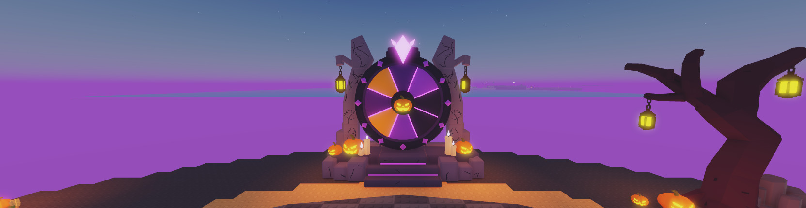
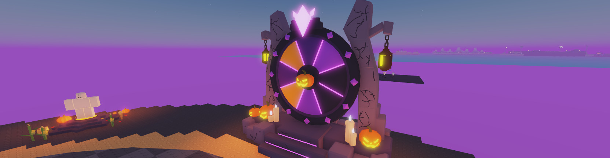
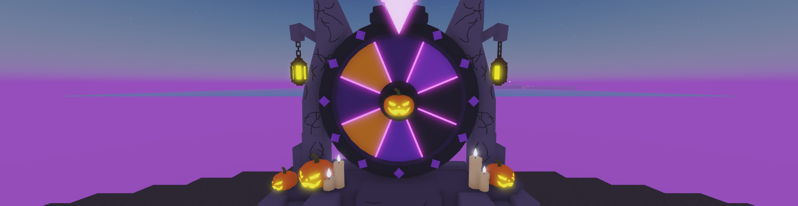

# HOS-LOBBY-007: Halloween spin wheel (structure)

Matthew asked for the structure only, with the wheel's slots left blank for now, the kit pumpkins and candles on it, and the textures the incubator and the rest of the game use:
1. First brief, with a concept sheet (`HOS-LOBBY-007/spin_wheel_concept.webp`): "Generate a spin the wheel structure such as this. Don't worry too much about the content being displayed in the wheel slots for now… place the pumpkin lanterns and candles onto it… use the textures that the incubator and rest of game uses."
2. With a front-view concept (`HOS-LOBBY-007/spin_wheel_frame_concept.webp`): "frame needs to look like this. Don't have them be blocks either, it needs to be meshes for mostly everything."
3. "The two things that hold the lanterns are curving outward. They need to curve inwards with the only branch outward being a short thing for the lantern to hang from."
4. "More tightly fitted and a bit more skinny like in the concept. Go 1:1."

## Where
`Workspace.SpinWheel` sits on the open south end of the island, centred at (0, 10, 1451) and facing north towards the altar. That mirrors the incubator, which faces in from the west. It's 23.6 wide, 21.2 tall and 10.2 deep. Its pivot is on the ground at the base's middle, so `SpinWheel:PivotTo(...)` moves it. A clash check found nothing in the lobby overlapping it.

## How it's made
The frame and wheel are meshes generated by `tools/build/HOS-LOBBY-007_spin_wheel_meshes.py`. The output is `docs/HOS-LOBBY-007/SpinWheel.glb` (16 parts, about 4,300 triangles), with a preview in `SpinWheel_preview.png`. Matthew imported it with File → Import 3D as mesh asset 77722287179737. `tools/build/HOS-LOBBY-007_spin_wheel_meshes.lua` then assembles the import in Studio.

Every size is measured 1:1 off the front-view concept. The rim's outer radius of 380 px is 7.45 studs, so 1 px = 0.0196 studs.
- **Base:** 3 studs tall and 23.6 wide, octagonal in plan.
  - Three steps up the middle (1.1, 2.2 and 3.3 high). The top one is the stand the wheel sits over, and the stand and middle step have purple glow strips on their risers.
  - Stepped blocks either side of the stairs, two blocks stacked at each post's foot, and a row along the back.
  - Bevelled low-poly stone with dark crack lines.
- **Posts:** about 2.4 studs wide. They rise from the base leaning inward to hug the rim, standing just behind it so the wheel turns in front, then go up to a slanted top at 21.2. Each puts out one short arm near the top, ending in a hook. A tree lantern, scaled to 4.4 tall, hangs from each hook; the lanterns have `A03_Chain`, so the client's LobbyAmbience swings them. The generator checks that the posts stand behind the wheel.
- **Wheel:** centred 10.7 studs up.
  - A dark backing disc and a thick bevelled rim (6.3 to 7.45) with a thin inner band.
  - 11 faceted purple gems round the rim, with none at the top under the crystal.
  - 8 sectors in the concept's colours, glowing purple dividers, and a raised hub ring (1.9) with the kit pumpkin as its emblem.
  - The sectors are blank for now: `Wheel.Sectors.Sector_1` to `Sector_8`. `Sector_1` is the top one under the pointer and the rest go clockwise as you face it. Each has a `Slot` attribute.
- **Spinning:** `Wheel.PrimaryPart` is `Hub`, and the wheel turns about the Hub's front-back (Z) axis. Everything else (base, posts, frame, props) stays still, and none of it is inside the wheel's turning disc.
- **Pointer:** a long faceted neon crystal (16.5 to 20.6 studs) with two small side crystals. It sits on a dark mount block in front of the rim's top, which is held by a bar over the rim and a pillar behind the wheel.
- **Props:** sized and placed as in the concept. On the left, a big and a small kit pumpkin and two candles; on the right, two candles and a pumpkin. The candles stand in front of the rim's gems.
- **Lights:** 4 in total, from the two big pumpkins and the two lanterns.
- **Materials:** stone is Plastic in the incubator's purple-grey family, with the accents in Neon.

## Backups
The first version, built from Studs-surfaced parts (`tools/build/HOS-LOBBY-007_spin_wheel.lua`), is at `ServerStorage._Backups.HOS-LOBBY-007_2026-10-18_BlockSpinWheel`.

## Next
- What goes on the 8 sectors (rewards and icons).
- The spin: a server-side result, then the client turns the `Wheel` model so the winning sector stops under the pointer, plus a prompt to spin.
