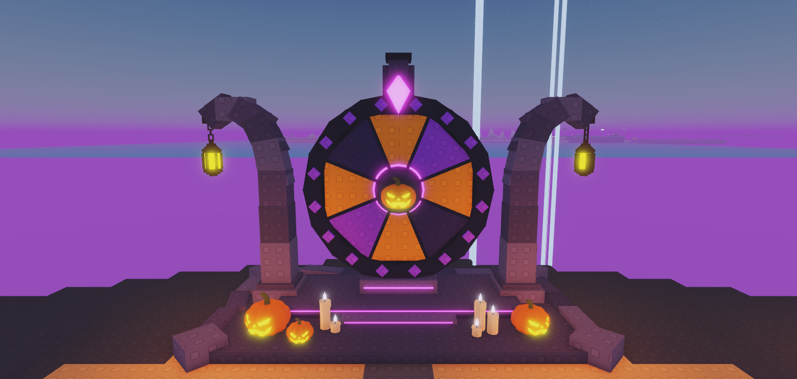
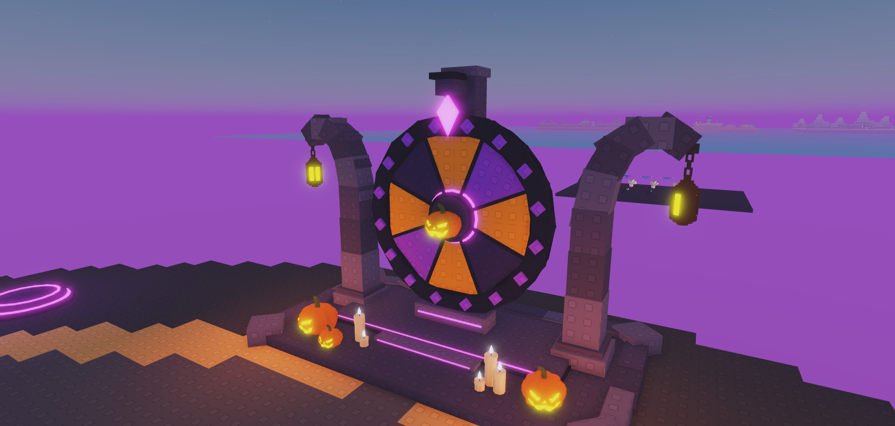
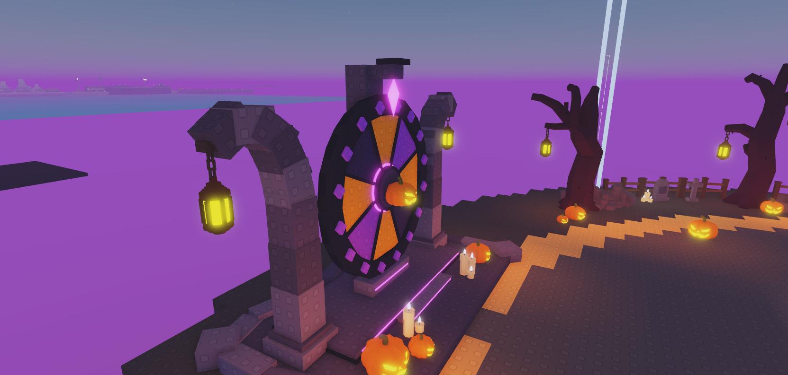

# HOS-LOBBY-007: Halloween spin wheel (structure)

Matthew, with a concept sheet (`HOS-LOBBY-007/spin_wheel_concept.webp`): "Generate a spin the wheel structure such as this. Don't worry too much about the content being displayed in the wheel slots for now. Just make the structure and then place the pumpkin lanterns and candles onto it. Same with the textures, we will use the textures that the incubator and rest of game uses."

## Where
`Workspace.SpinWheel` sits on the open south end of the island, centred at (0, 10, 1451) and facing north towards the altar. That mirrors the incubator, which faces in from the west. The whole build is about 30 wide (lantern to lantern), 19 tall and 16 deep. It's one model with its pivot on the ground at the centre, so `SpinWheel:PivotTo(...)` moves it anywhere. A clash check found nothing in the lobby overlapping it.

## What it is
Built like the incubator: Plastic with Studs surfaces in its purple-grey stone (74,63,99 / 93,83,121 / 64,57,88 / 68,60,94 / 59,52,82), dark navy trim, and purple neon (180,92,255) only as thin accents. 229 parts.
- **Base:** a 26 × 14 stone slab with chunky edge blocks along the sides and back. Some blocks are turned 15° and the corner blocks 45°. A raised tier for the wheel has a dark lip, and a front step has neon strips on its riser and the tier's.
- **Posts:** two stone posts that rise either side of the wheel and hook outward over the top. Each is a chain of segments turning 0° → 125°, with knuckle blocks so the bends stay closed. An iron bracket at each tip holds a lantern cloned from the trees. The lanterns have `A03_Chain`, so the client's LobbyAmbience swings them like the others.
- **Wheel:** a dark backing disc, 8 sectors (orange / purple / orange / deep purple), dark spokes, a 16-block navy rim with a purple diamond stud on each block, and a hub with a neon ring and a kit pumpkin as the emblem (no light). The sectors are blank for now: `Wheel.Sectors.Sector_1` … `Sector_8`, where `Sector_1` is the top one under the pointer and the rest go clockwise. Each has a `Slot` attribute.
- **Spinning:** `Wheel.PrimaryPart` is `Hub`, and the wheel turns about the Hub's front-back (Z) axis, so a spin script can rotate the `Wheel` model about that axis. The pointer, frame and posts are separate models and stay still.
- **Frame:** a pillar behind the wheel carries the axle and an arm over the top, making an L-shaped bracket. A faceted crystal pointer (neon front, purple back) hangs under the arm, just in front of the rim's studs so the wheel can turn under it. A cradle under the wheel has a neon strip.
- **Props:** kit pumpkins on the front corners (a big and a small one on the left, one on the right) and two kit candle groups by the step. Only the two big pumpkins keep their lights, and the candles share them, following the HOS-LOBBY-006 rule. With the two lanterns that makes 4 lights.

## Rebuild
`tools/build/HOS-LOBBY-007_spin_wheel.lua` (deterministic). It replaces `Workspace.SpinWheel`, so any hand edits to the model in Studio are lost on a rebuild.

## Next
- What goes on the 8 sectors (rewards and icons).
- The spin itself: a server-side result, then the client tweens the `Wheel` model so the winning sector stops under the pointer, plus a prompt to spin.
