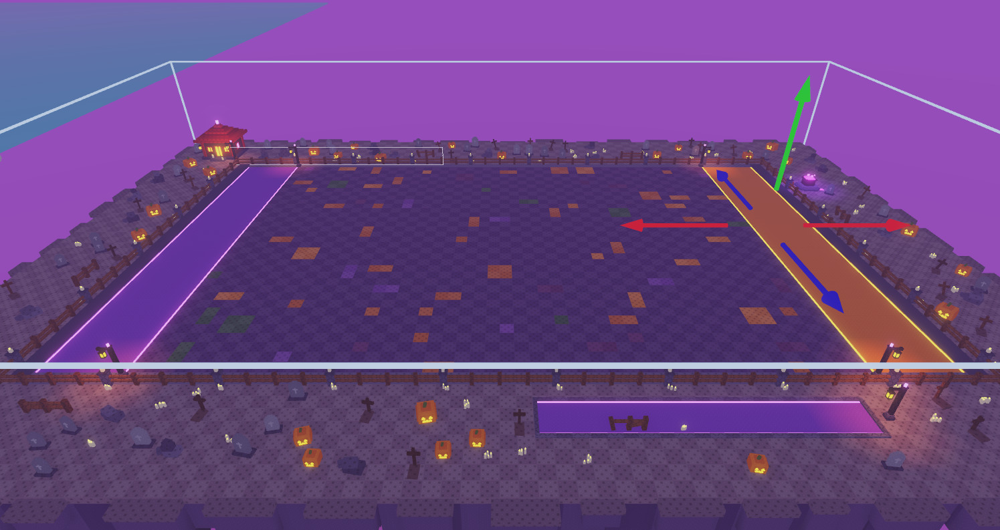
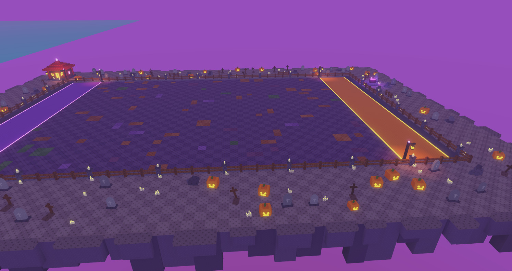
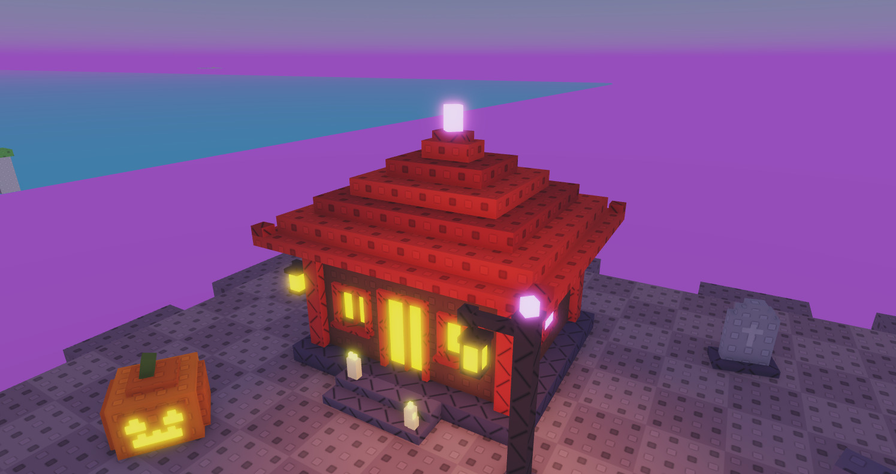
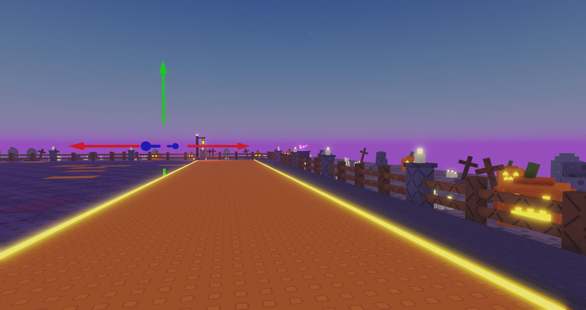

# HOS-MAP-001: Haunted Graveyard arena

A halloween sharks-and-minnows arena built from Matthew's approved concept (`docs/concepts/HOS-MAP-001_halloween_arena_concept.webp`). The build is a preview next to the other maps. It isn't in the match rotation yet.

The overview was taken with the Ground model selected, which is where the outline comes from. Later screenshots were blocked because a playtest was running.

## Where it is
- **Studio:** `Workspace._MapPreview.Preview_Graveyard`, centred at x 1313.25, z −390. That's the next slot east of `Preview_Stadium`, at the same 430-stud spacing.
- **Builder:** `ServerStorage.EOSBuild.Maps.BuildGraveyard` (new). It uses the shared `ArenaFrame`, like the other map builders.
- **Definition:** `MapDefs.Graveyard`: Stadium sizes (field 192 × 140, `FIELD_HALF_X` 96, `ZONE_DEPTH` 24, `HALF_Z` 70), title "Haunted Graveyard", lobby colours from the field and cliff.
- **Rebuild the preview:** require `MapDefs` and `BuildGraveyard`, call `build(folder, MapDefs.Graveyard)`, then pivot the result by (1290, 0, 0). The build is seeded, so it comes out the same every time.

## What's in it
| Area | Build |
|---|---|
| Field | Dark purple studded floor with 72 flat colour patches on a 4-stud grid: mostly muted orange that blends into the floor, some purple, a few dull green. No cover, per Matthew. |
| Safe zones | A is purple and B is orange. Glow strips run along both long edges of each lane. Each zone is simply the floor past the field; past the zones is out-of-bounds paving. No chalk lines or flags. The tall back walls are now a low stone kerb. |
| Fence | Wooden ranch fence around the play area. Every fourth post is a stone pillar with a candle on top and candles at its foot. |
| Lantern posts | 5 posts with stone feet, purple crystal tops and hanging orange lanterns: one at each end of both zone edges and one by the shrine. |
| Walkways | 38 gravestones, 24 wooden crosses on grave mounds, 28 jack-o'-lanterns, 36 candle clusters and 19 stone-block ruins. Nothing overlaps. |
| Set pieces | A red stepped-roof shrine (back-left, lit inside, purple crystal on top) and a bubbling purple cauldron on a stone ring (east). |
| Loose fences | 5 standalone fence pieces near the boundaries (2 broken) in `Scenery.LooseFences`, for moving or copying. |
| Island | Paved top over a stepped cliff, plus 114 chunky stone columns hanging under the edges, like the concept's underside. |

Not built, by request: trees, the sky, moon, castle and clouds, other off-island assets, and lighting changes. The lanterns, cauldron and fence candles carry their own small PointLights, the same way `Kit.lamp` does on the other maps.

## Gameplay checks (done in Studio)
- Downward raycasts across both zones, including right on the glow strips, hit `Pad` with `Side` = A or B. Raycasts on the field hit `Field`.
- The field patches and glow strips have `CanQuery`, `CanCollide` and `CanTouch` off, so they can't block zone detection.
- There are 2 `EOS_Gate` gates, 2 `EOS_CatcherWall` walls and 4 invisible `ArenaWalls`. These are the same `ArenaFrame` pieces every map uses.
- The map attributes (`Map`, `MapTitle`, `FIELD_HALF_X`, `ZONE_DEPTH`, `HALF_Z`, `WALL_HEIGHT`, `CENTER`, `LobbyTop`/`LobbyBase`) are set like the other maps.

## Build checks
- **Clipping:** no prop overlaps another prop, the fence or the set pieces.
- **Flicker:** an automated sweep for shared face planes found 0 visible pairs. The fixes before it reached 0:
  - The fence corners had doubled posts and rails crossing at the same height (the `ArenaFrame` fence does this on every map).
  - The shrine's window sills and lantern bracket shared faces.
  - The cauldron's puddle overlapped its stone ring.

## Changes after review (17 Oct, Matthew)
- **Removed the glowing pool on the lobby side**, along with its stone rim, the broken fence and candles in it, its lantern post and the cross beside it. The walkway props now fill that space. Because the props are placed in sequence from one seed, removing the pool also moved where every walkway prop lands.
- **Muted the orange field patches** to rgb(136-156, 78-92, 66-68). They're still orange but sit closer to the floor's darkness, so they tint it instead of popping.
- Re-ran both checks after the rebuild: 0 overlaps and 0 visible shared faces.
- Pre-change builder: `docs/backups/HOS-MAP-001_2026-10-17/ServerStorage.EOSBuild.Maps.BuildGraveyard.before-pool-removal.lua`.

## Not done yet / for Matthew or Hunter
- **Rotation:** the map isn't in the game yet. To add it, `BuildAll` needs `"Graveyard"` in its maps list (it then builds `Arena_Graveyard` into `ServerStorage.EOS_Maps`, and `MapService` and `MapVoteService` pick it up). That's a one-line change in a shared build script, so it's left for the owner to decide.
- **Out-of-bounds ground:** it's stone paving to match the concept. For grass instead, change `G.pave` and `G.pave2` in `BuildGraveyard`.
- **PetLab overlap:** `EOS_PetLab` floats about 18 studs above the island's south-east corner. Fine for a preview, but move one of them if it gets in the way.
- **ScriptHistory:** this ticket snapshotted `BuildGraveyard` and `MapDefs`. The full-place snapshot was taken afterwards under HOS-LB-001.
- **Backups:** the pre-edit `MapDefs` and the builder from before the pool was removed are in `docs/backups/HOS-MAP-001_2026-10-17/`.
