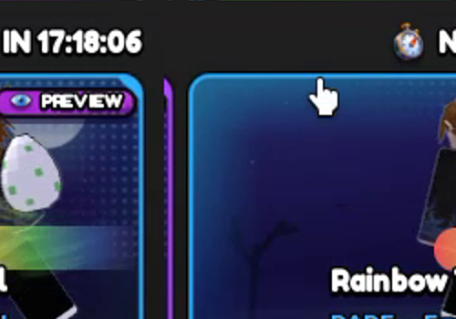
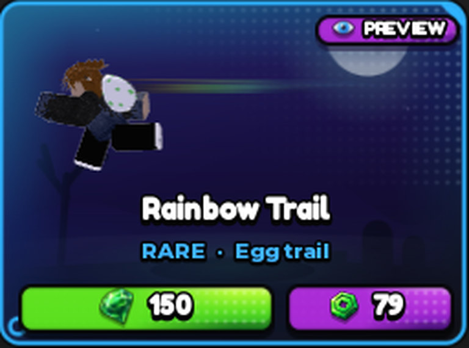
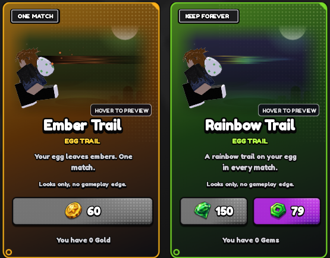

# HOS-PREV-001: Egg trail shop preview (framing, real trail look, run clip, open zoom glitch)

Matthew (with a screen recording of the Featured page's Rainbow Trail card): "Next thing I need fixed is the viewport of the trails. They look bad and I hope the trail doesnt look like that in game. You could move the player all the way to the left on the viewport so the trail can be seen in the center/right side. There's also this bug tween issue when the viewport starts, it zooms out then zooms in as if the zoom is tweaking on tween", then "Also, it should be their running animation, not the walk".

| Before (his recording) | After |
|---|---|
|  |  |

## The zoom glitch
Two scripts sized the preview at once on a Featured daily card:
- `FeaturedShopUI.fullCard` set the stage straight to the whole card (336×244).
- `ShopItemPreview`'s 0.25 s open tween was taking it to the art strip (328×100).

Measured frame by frame, the stage shrank from 221 to 100 tall over the tween, so the scene zoomed out. A delayed fix 0.3 s later then snapped it to 244, so it zoomed back in.

Now `fullCard` plays the open tween itself, straight to the whole card. The newer tween on the same properties cancels the older one. Re-measured, the stage only grows: 90 → 128 → 161 → … → 244 tall (90 → 336 wide), then holds. This covers every preview on a daily card (trails, effects, pets), not just trails.

## The trail scene (ShopItemPreview `trailScene`, used by the Featured and Cosmetics trail cards)
- **Where you stand:** the camera is worked out every frame. Your middle sits 26% across the stage, and your height fills 80% of the scene.
  - On a Featured daily card, the scene ends above the card's name and buttons. `FeaturedShopUI` sets `SceneBottom = 0.55` on the stage.
  - The trail gets the centre and right side, and the size holds steady whatever shape the card is.
- **Animation:** the run clip (`AnimConfig.ids.Run`, what a Runner plays at speed in a match) at normal speed, not the walk.
- **The trail itself:** drawn the way a match draws it (`EconomyService.trailOn` / `TRAIL_LAYERS`):
  - each layer's own texture, stretched along the trail;
  - 0.8 studs tall (times the layer's width), starting at the egg;
  - the rainbow running red at the egg to purple at the tail as it fades;
  - the shorter-lived second layer shorter.

  The old preview drew a fat rounded colour bar plus streaks, not tied to the egg.
  - A viewport can't draw Trails, so the layers are flat pictures on a layer just under the 3D. Your egg and back cover where the trail starts, as in a match, and it follows the egg's bob a touch behind.
  - Each layer is drawn 3 times over itself (`TRAIL_GLOW`). In a match the trail adds light (`LightEmission`); flat pictures only blend, so one pass read too faint on the dark card.
  - The textures start blank, so 15% of each layer's length sits back under the egg (`TRAIL_LEAD`). That way the wisp starts at the egg instead of floating off it.
- Sparkle / Ember trails keep their sparks; they now come off the egg wherever it is on screen.

## What the trail looks like in a match
A test in the playtest used a ball at Runner speed (31 studs/s, `GameConfig.Movement.RUNNER_SPEED`) with the exact Rainbow Trail layers. In a match the trail is a **long, thin, pastel wisp**: about 17 studs long and 0.8 studs tall, faint over most of its length.

The preview matches those proportions (length about 2.6 character heights in the card against about 3 in a match; height 14% of you in both). If the trail should read bolder in matches too, that's `EconomyService.TRAIL_LAYERS` / `trailOn` (width, transparency, LightEmission, or a bolder texture). It wasn't changed here.

## Scripts and undo
- `StarterPlayer.StarterPlayerScripts.EOS.Controllers.ShopItemPreview`: `TRAIL_TEX` → `TRAIL_LAYERS`, `trailScene` rewritten (46,899 bytes).
- `…Controllers.FeaturedShopUI`: `TweenService`, `SCENE_BOTTOM`, and `fullCard` tweens to the whole card (38,062 bytes, CRLF).
- Backups of both as they were: `docs/backups/HOS-PREV-001_2026-10-18/`.
- ScriptHistory: `ShopItemPreview.lua` updated. It was behind Studio, so it now matches the live script plus this change. `FeaturedShopUI.lua` was added.
- Studio undo steps: "HOS-PREV-001 trail preview", "… trail framing", "… run clip", "… trail x".
