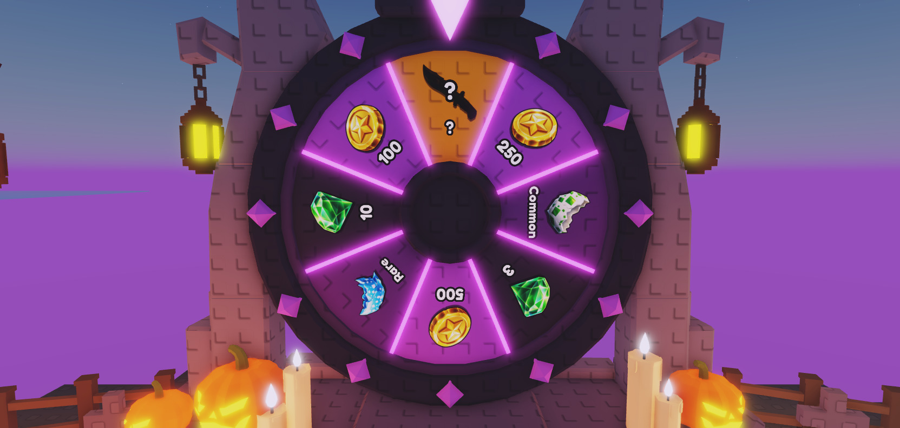
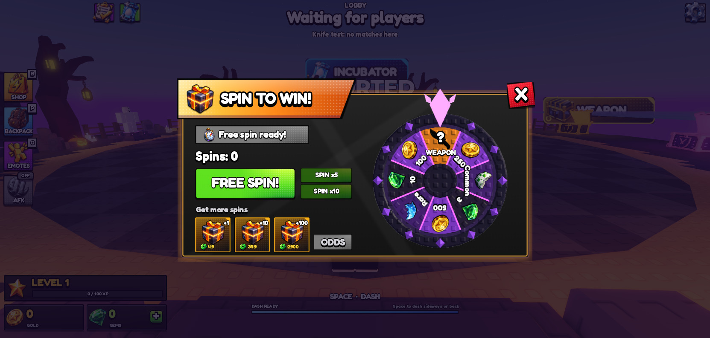
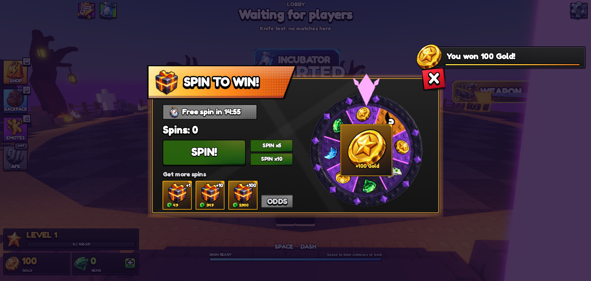
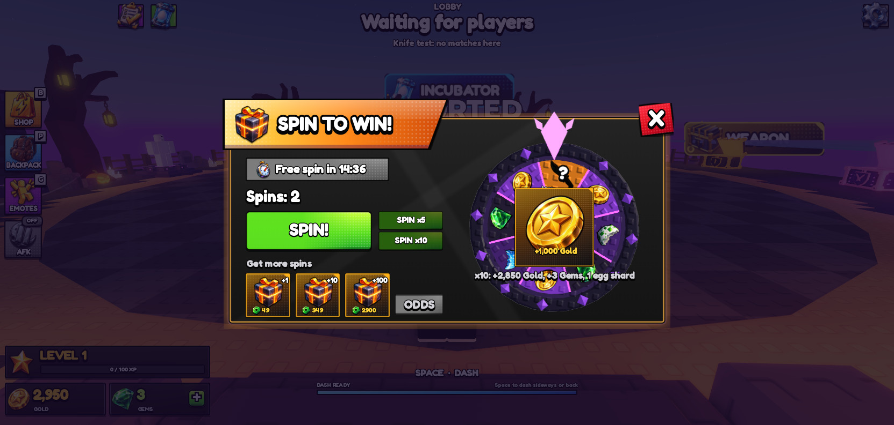
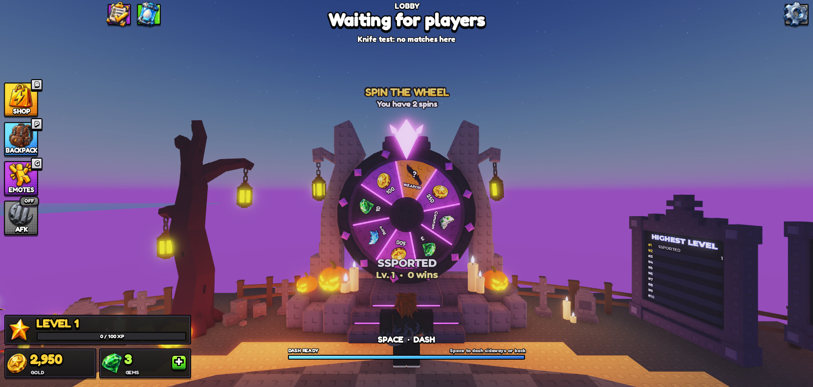
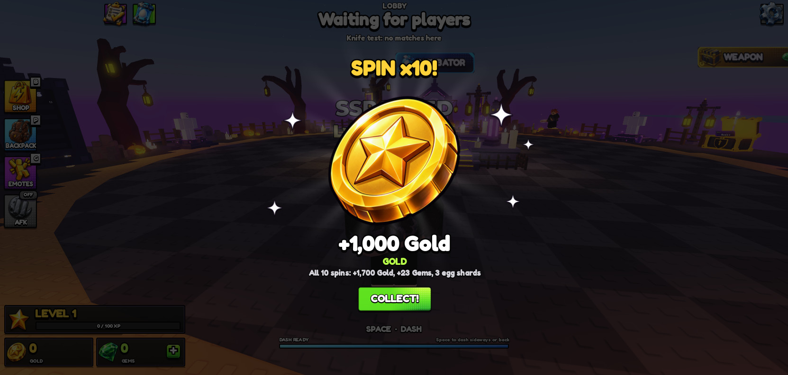
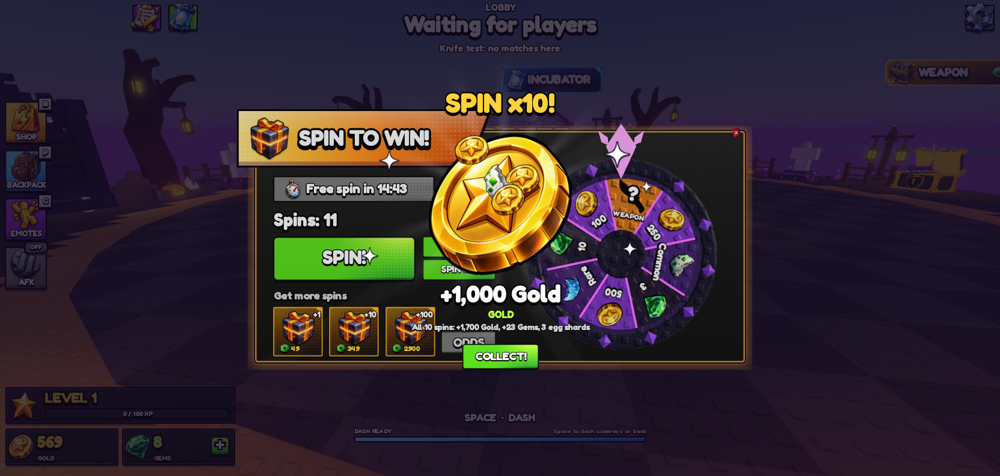
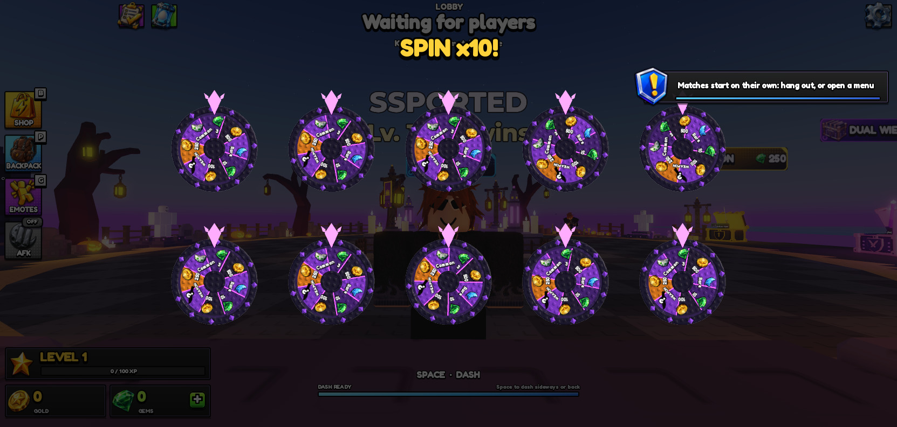
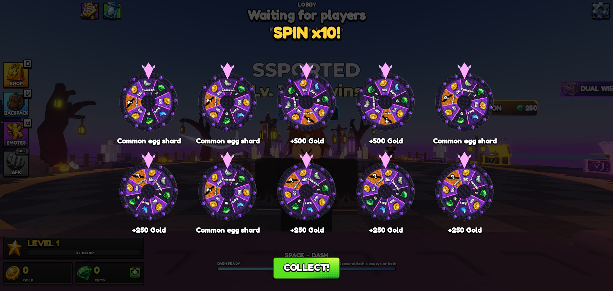
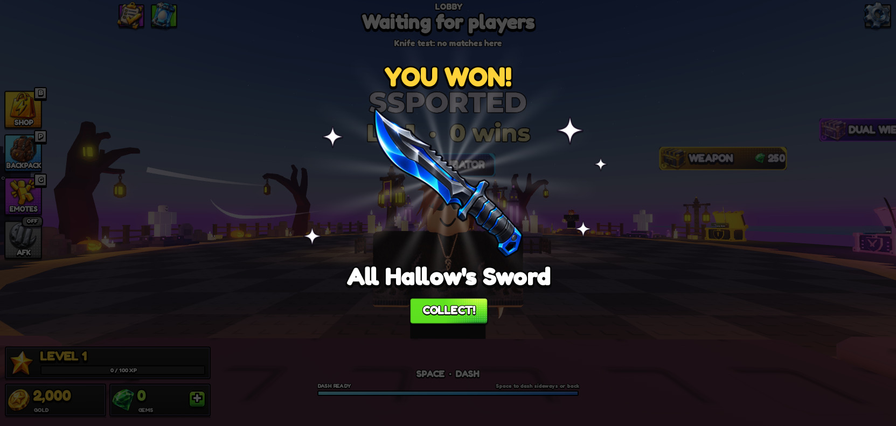

# HOS-SPIN-001: Spin wheel rewards, spin screen and spins

Matthew: "Let's begin working on the spinner and UI. We want the spinner to have one orange slot for the weapon. The other 3 can be Coins, gems, and egg shard for incubator contribution. go ahead and get those onto the wheel itself and make the UI for it… We can make an improved looking version of this with the UI theme we have now. But create the UI and hook it up. Have the weapon be placeholder for now until I specify which weapon it is."

The game's coins are Gold, so "Coins" is Gold here.

## The 8 slots (`ReplicatedStorage.EOS.Shared.SpinWheelConfig`)
Slot 1 is the top sector, under the crystal, and the rest go clockwise as you face the wheel. Only the weapon slot is orange. The others alternate purple, deep purple and dark, with no two neighbours the same.

| Slot | Reward | Chance |
|---|---|---|
| 1 | **Weapon**: placeholder All Hallow's Sword, shown as a dark knife with a "?" | 1% |
| 2 | 250 Gold | 20% |
| 3 | Common egg shard | 17% |
| 4 | 3 Gems | 15% |
| 5 | 500 Gold | 12% |
| 6 | Rare egg shard | 9% |
| 7 | 10 Gems | 6% |
| 8 | 100 Gold | 20% |

How each reward pays:
- **Egg shards** go into the incubator like a match shard (`EggLogic.addShard`). They're also added to `incubator.unseen`, so they fly into the egg next time the player walks up to the incubator.
- **Weapon:** slot 1's `weaponId` is the weapon it gives, owned and equipped. A duplicate gives Weapon Shards, as a crate does.
  - At first it was unset and paid 1,000 Gold instead, so the wheel could land on the weapon and pay Gold. Matthew: "Make sure what it lands on is actually what they get."
  - It's now set to `knife_rb_all_hallow_s_sword` as a stand-in until Matthew picks the weapon.
  - `mystery = true` keeps the dark "?" knife on the wheel.
- The odds, amounts, colours and icons are all in the config. I checked the odds over 100,000 test rolls: they came out within 0.3% of the table.

## On the wheel itself (`Workspace.SpinWheel`)
- The sectors are recoloured from the config, and each has a `Reward` attribute.
- `Wheel.Labels` is an invisible plate just in front of the sectors. It holds one SurfaceGui with an icon and amount per slot. Because it's part of the Wheel model, it turns with the wheel.
- `SpinSign` is a camera-facing sign over the crystal. It reads "SPIN THE WHEEL", and underneath shows each player their own free-spin timer, "Free spin ready!" or "You have n spins".
- The model is set to stream in whole (`ModelStreamingMode` Atomic), so the client always has the entire wheel to turn.
- The wheel has been moved to the east side of the plaza since HOS-LOBBY-007. Its pivot is at (49.9, 10, 1500.3), facing west to the centre. All the new code works from the model's pivot, so it keeps working if it moves again.

Built by `tools/build/HOS-SPIN-001/wheel_labels.lua`.

## The spin screen (`StarterGui.SpinWheelUI`)
It uses the theme of the welcome-back gift card: a dark panel with an orange border, the orange banner, green buttons, gold tiles, the grey plate and the red X. It's a copy of `RetentionUI`, so it gets the same UI module (scrim, Escape, phone scale, button juice). No new art was needed.

Compared with the reference, the screen has one weapon slot instead of two. The wheel is a live 3D copy of the lobby wheel, and the prize gets its own popup when it stops.

**Left side**
- The "SPIN TO WIN!" banner.
- The free spin timer and a "Spins: n" count.
- **FREE SPIN! / SPIN!**, **SPIN x5** and **SPIN x10** buttons. A button greys out when you don't have enough spins; pressing it then says why.
- "Get more spins": +1, +10 and +100 tiles priced in Robux.
- **ODDS**: switches the wheel's amounts to percentages and back.

**Right side**
- The wheel, a ViewportFrame with a copy of the lobby wheel and crystal. The reward icons ride on their sectors as it turns. It spins clockwise with a ticking sound, then eases onto the result.
- When it stops, the prize popup opens (below).
- **SPIN x5 / x10** open that many wheels at once instead (`Root.Multi`, over the same black shade): 5 in a row, or 2 rows of 5.
  - They all start together and each settles in its own time, landing on its own roll. The prize shows under each wheel as it lands (a wheel landing on 250 Gold paid exactly that), then **COLLECT!** appears.
  - On collect, each prize flies home from its own wheel.

### The prize popup (added the same day)
Matthew: "Have the reward kinda be its own GUI that pops up in the middle of the screen with the rest of the background kinda shaded black. And then if it's gems/coins, they transition and tween as individual gems/coins to the bottom left. If it's an egg shard, it tweens into egg shards going to the top left incubator button for HUD."

This replaces the small prize tile over the hub.
- **The popup** (`SpinWheelUI.Root.Prize`) is a copy of the shop's reward reveal: spinning rays, sparkles, the big icon and the prize name.
  - The kind and total lines were removed. Matthew: "Remove the Description here."
  - It sits over a black shade (85% black) with one **COLLECT!** button. Escape or a tap on the shade also collects.
- **Collecting** sends everything home from the popup's icon:
  - Gold flies as single coins (6 to 14) to the Gold icon in the HUD wallet, bottom left.
  - Gems fly as single gems (4 to 10) to the Gems icon.
  - Each egg shard flies to the HUD's incubator button, top left.
  - The icons burst out first, then curve in and shrink. Where they land there's a sparkle and a rising "+250" or "+3 shards".
- **The wallet waits:** the Gold and Gems numbers stay put from the moment you spin, then count up as the first coin lands.
  - To do this without editing UIController, the controller wraps EOSUI's `UI.countTo` for the "gold" and "gems" keys while a spin is held.
  - It always lets go: after 15 s, or 2 min if the popup is left open.
- In a match there's no popup; the prizes just fly home.
- Built by `tools/build/HOS-SPIN-001/build_prize.lua`, which runs after `build_ui.lua`. The flying icons go on the `SpinWheelUI.Fly` layer.

Tested:
- **x10 with the popup version** (+1,700 Gold, +23 Gems, 3 shards): while the wheel turned and the popup was up, the HUD stayed at 0 / 0. On COLLECT!, the coins, gems and shards flew out and the wallet counted up to exactly 1,700 / 23. The fly layer was empty afterwards.
- **x10 with ten wheels:**
  - Every wheel's top sector matched the prize under it: 4 common shards, 2 × 500 Gold and 4 × 250 Gold.
  - The wallet ended at exactly 2,000 Gold, the sum of the labels.
  - Shards flew to the incubator button and coins to the wallet, each from its own wheel.
- **Weapon:** I forced one roll to slot 1 (temporarily, in the playtest only).
  - The single wheel landed on the weapon, and the popup showed "All Hallow's Sword".
  - The profile owned and had equipped `knife_rb_all_hallow_s_sword`, and Gold was unchanged.

**Opening and closing:** walking up to the front of the wheel opens the screen, and walking away closes it. If the player closes it with X, it stays shut until they walk away and come back. It never opens in a match, while spectating, or over another panel.

Built by `tools/build/HOS-SPIN-001/build_ui.lua`. The controller is `StarterPlayerScripts.EOS.Controllers.SpinWheelController`, started from `ClientMain`.

## How spins work (server)
`ServerScriptService.EOS.Services.SpinWheelService` is started from `Bootstrap`. Its remotes are in `ReplicatedStorage.EOS_SpinWheel`: State, Ask, Spin and Spun.
- **Free spin:** each player has one free spin. After it's used, the next is ready 15 minutes later (`FREE_SECONDS`). A new player's first spin is free.
- **Bought spins** are kept in `profile.spinWheel.spins`.
- **A spin of 1, 5 or 10** uses the free spin first, then bought spins.
  - The server rolls every result before it saves, then pays them all in one save.
  - The save is guarded by a spin id, so a retried save never pays twice.
  - A player can't start another spin while the wheel is still turning (4.2 s).
- **Everyone sees the spin:** when anyone spins, every client near the lobby wheel turns it to the result over the same 4.2 s. Clients far away or in a match just jump it to the result.
- **Spin packs:** a Robux receipt goes to `SpinWheelService.processReceipt` from `PurchaseService.processOther`. Spins are granted only after the save, once per receipt, using the wheel's own receipt ledger.

## Tested (Studio playtest, memory-only data)
- Walking up opened the screen showing "Free spin ready!" and **FREE SPIN!**, with SPIN x5 and x10 greyed out.
- **FREE SPIN!** landed on 100 Gold: Gold went 0 → 100, and the timer reset to 15:00.
- I gave the test player 12 spins, then pressed **SPIN x10**. Spins went 12 → 2, Gold +2,850, Gems +3, and one common shard was added to the incubator's fly-in list. The wheel landed on the orange weapon slot, which paid the 1,000 Gold placeholder.
- The lobby wheel stopped on the same slot, and the sign read "You have 2 spins".
- No errors in the output.

## Waiting on Matthew / Hunter
- **The weapon:** it's the All Hallow's Sword (legendary) as a stand-in. Say which one and it's one line (`weaponId` on slot 1).
  - The popup uses the generic knife icon, because knife skins have no 2D icon; the shop shows them as 3D previews.
- **Robux spin packs:** prices are placeholders (49 / 349 / 2,900, as in the reference). They need developer products created, and the ids go in `SpinWheelConfig.PACKS`. Until then the tiles say "Spin packs aren't on sale yet".
- **Free spin interval:** 15 minutes, to match the reference. Change `FREE_SECONDS` if you want something else.
- The stud texture on the wheel is still the egg-pack one with "L"s until the custom stud texture is uploaded (see [[HOS-LOBBY-007 Spin wheel]]).

## Backups
- Studio: `ServerStorage._Backups.HOS-SPIN-001_2026-10-18` holds the old `PurchaseService`, `Bootstrap`, `ClientMain` and the wheel's old `Sectors`.
- Repo: `docs/backups/HOS-SPIN-001_2026-10-18/` has the old sources of the three scripts.
