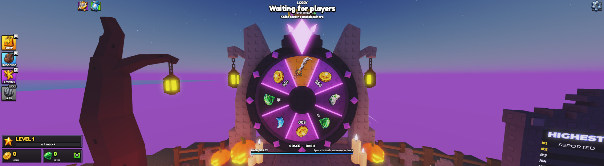
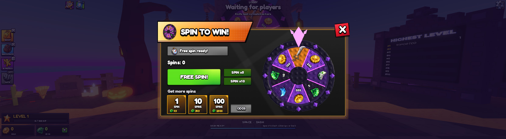
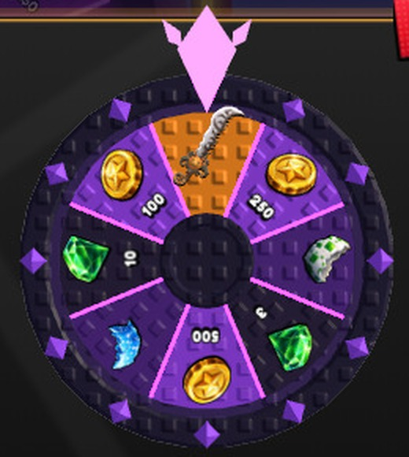

# HOS-SPIN-002: The spin wheel's weapon slot shows the All Hallow's Sword

Matthew: "Have the weapon be the hallow icon for spin the wheel since thats what the item is", then "You can remove the "WEAPON" label on the slot with the hallow. just takes up space for no reason" and "Same with the Common and rare label on the shards".

The wheel's weapon slot (slot 1) already paid out the All Hallow's Sword (`SpinWheelConfig.SLOTS[1].weaponId = knife_rb_all_hallow_s_sword`). But it was set to `mystery`, so it showed a dark knife with a "?" and the word WEAPON. It now shows the sword itself on both wheels.

## What changed
- **SpinWheelConfig**
  - Slot 1 is no longer `mystery`.
  - `C.short` returns no text for a weapon slot (unless it's a mystery weapon) and for shard slots. The ODDS button still writes each slot's chance in that space.
- **SpinWheelController**
  - Knife skins have no 2D icon. So the weapon slot gets a 3D render of the skin (`WeaponShopUI.renderSkin`, the same render the prize popup already uses), plus a black copy for the shadow. Size: 1.75× the old icon, set slightly low in the slot (`WEAPON_ZOOM`, `WEAPON_DROP`).
  - It is applied to:
    - the spin screen's wheel
    - each x5 / x10 wheel as it's made
    - the big lobby wheel
  - Lobby wheel: a 3D render on a SurfaceGui that lives in the Workspace draws nothing (tested). So the weapon slot is copied onto a client SurfaceGui in PlayerGui (`SpinWheelWeapon`), adorned to the same part (`Wheel.Labels`). It turns with the wheel, and it is made again if the wheel streams out and back in.
  - The dark knife stays underneath as a stand-in until the server has sent the skin previews (a second or so after joining). Then it hides.
- **The place's UI:**
  - The "?" labels are deleted from `StarterGui.SpinWheelUI…Slots.Slot1` and `Workspace.SpinWheel.Wheel.Labels.Rewards.Slot1`.
  - The WEAPON, Common and Rare texts are blanked on both wheels (9 labels).
- **Build scripts** (`tools/build/HOS-SPIN-001/build_ui.lua`, `wheel_labels.lua`): the weapon icon is always the dark stand-in, and only a `mystery` weapon gets the "?". The labels come from `C.short`, so a rebuild matches.

## Checked (playtest)
- Spin screen: the sword render and its shadow are drawn. The old icon is hidden and there is no "?". The render turns with the slot as the wheel spins (tested by rotating the slot).
- Lobby wheel: the overlay is adorned to `Wheel.Labels`, and the sword shows in the orange slot. It stays in place when the wheel is turned 60°.
- The slot texts read: '' (weapon), 250, '' (Common shard), 3, 500, '' (Rare shard), 10, 100.
- No errors from SpinWheelController in the logs.
- Not run: an actual x5 / x10 spin (it needs bought spins, and I didn't touch the test profile). Those wheels are copies of the spin screen's wheel and get the same treatment as they're made.

## Backup and undo
- Scripts as they were: `docs/backups/HOS-SPIN-002_2026-10-18/` (`SpinWheelConfig.lua`, `SpinWheelController.lua`).
- Studio undo steps: "HOS-SPIN-002 weapon slot shows the sword", "HOS-SPIN-002 lobby wheel overlay", "HOS-SPIN-002 lift", "HOS-SPIN-002 no WEAPON label", "HOS-SPIN-002 shard labels + weapon size".
- To go back to the mystery look, set `mystery = true` on slot 1. The wheel keeps the dark knife, and a rebuild with the build scripts puts back the "?" and the WEAPON text.
