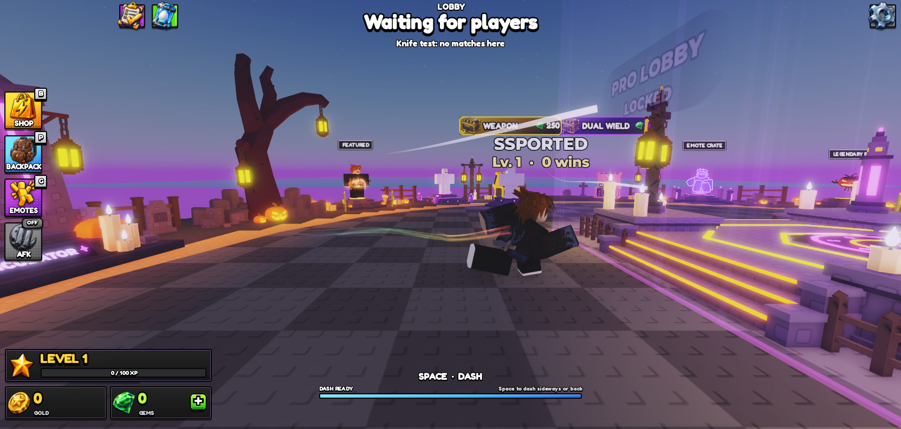
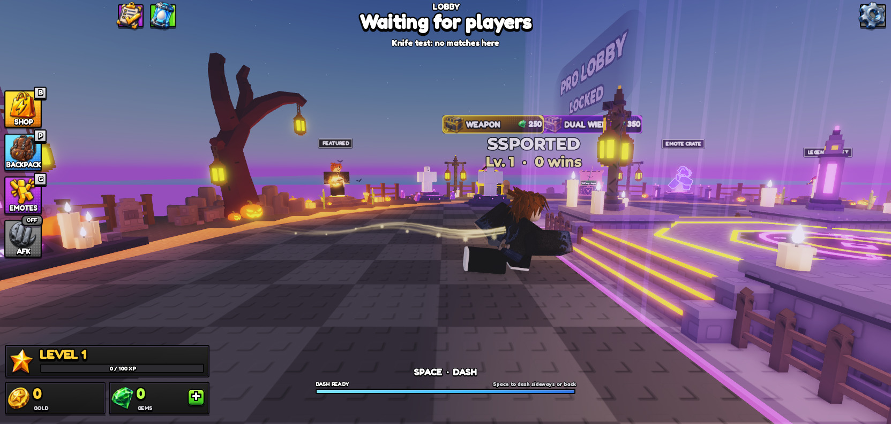
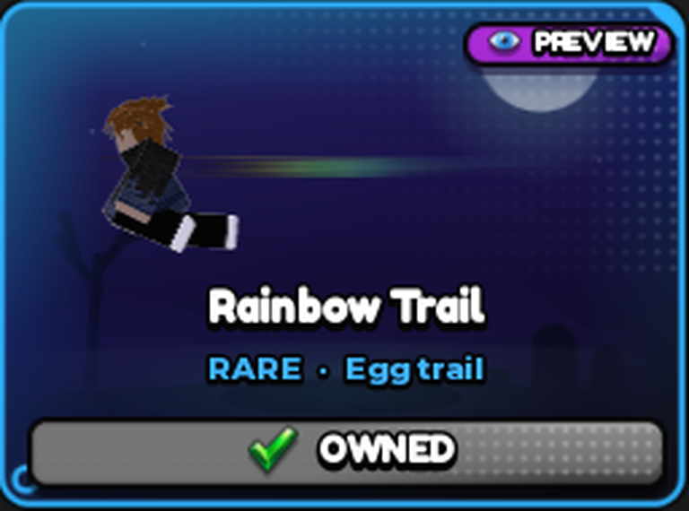

# HOS-TRAIL-001: Every trail for Matthew, trails shown in the lobby, no egg in the trail preview

Matthew: "Can you give me all the trails for me to try on? have them be able to equip in lobby. also, remove the egg from the viewport when viewing the trails".

| Rainbow Trail in the lobby | Sparkle Trail in the lobby | Shop preview, no egg |
|---|---|---|
|  |  |  |

(The long white streak in the rainbow capture comes from the test teleporting the character back to its start, not from the trail.)

## Every trail for Matthew
`EconomyService.giveTesterTrails` runs whenever a tester's save loads. `TESTERS` holds Matthew's account, ssported (user id 2403942283, the account signed in to Studio on his PC).
- Rainbow Trail (permanent) is owned.
- Sparkle Trail and Ember Trail (one-match trails) are topped up to 5 each (`TESTER_TRAILS`), so you never run out while testing.

To add another tester, add their user id to `TESTERS`. To stop it, remove the entry.

## Trails in the lobby
Equipping hasn't changed: it's the Backpack's existing controls. Arm a one-match trail, disarm it, or switch Rainbow Trail on or off; all go through `RequestSetCosmetic`.

What's new is that the trail your next match will wear streams off your back in the lobby. That's the armed one-match trail, otherwise Rainbow Trail if it's on, the same order `startMatch` uses.
- **Placement:** it's built like the match trail (`trailOn`: same layers, sparks on Sparkle and Ember). It sits on an invisible part (`EOS_LobbyTrail`) welded just off your back, at the height the egg rides in a match.
- **When it updates:**
  - on spawn;
  - straight away after a Backpack change or a trail purchase;
  - when a match starts (it comes off; the carried egg wears the trail in a match);
  - when you're back in the lobby.
- **Nothing is used up in the lobby.** An armed one-match trail is still used up when a match starts, as before.
- Other players see it too, since it's built on the server.

## No egg in the trail preview
The shop's trail preview (`ShopItemPreview.trailScene`) no longer puts an egg on your back. The trail comes off the same spot as in the lobby, on an invisible anchor that moves with the run.

## Checked (playtest)
- On load, the profile had Rainbow owned, Sparkle 5, Ember 5, and the Rainbow Trail was on your back in the lobby.
- Through `RequestSetCosmetic` (what the Backpack sends):

  | Action | Lobby trail |
  |---|---|
  | Arm Sparkle | Sparkle (its two textures) |
  | Arm Ember | Ember |
  | Disarm | Rainbow |
  | Rainbow off | none |
  | Rainbow on | Rainbow |

- Running in the lobby (side-on captures above): the trail streams off your back. Sparkle shows its sparks.
- Shop preview: no egg model in the scene, and the trail comes off your back.
- Not run: a full match (no other players). The match path itself is unchanged; the lobby trail removes itself when the in-match flag (`EOS_InMatch`) turns on.

## Going live
These are Studio edits: they reach the live game when the place is published. Studio playtests keep saves in memory only (`DataService`), so the grant re-runs every playtest and touches no live save there. In the live game it writes to your real save once per join, which is harmless since it only tops up.

## Scripts and undo
- `ServerScriptService.EOS.Services.EconomyService` (20,438 bytes): `nextTrail`, `refreshLobbyTrail`, `giveTesterTrails`, and hooks in `onBuy`, `onSetCosmetic`, `CharacterAdded`, `EOS_InMatch` and `DataService.Loaded`.
- `StarterPlayer.StarterPlayerScripts.EOS.Controllers.ShopItemPreview` (47,599 bytes): `trailScene` uses a back anchor instead of the egg.
- Backups as they were: `docs/backups/HOS-TRAIL-001_2026-10-18/`.
- ScriptHistory: both updated. EconomyService's copy was behind Studio, so it now matches the live script plus this change.
- Studio undo step: "HOS-TRAIL-001 lobby trails + tester grant".
