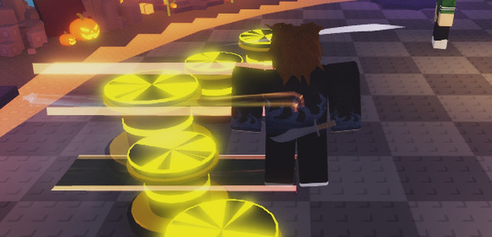

# HOS-TRAIL-002: The dash streaks wear your trail

Matthew: "Can you have the dash beams be the trail beams as well?"

The "dash beams" are `SlideFX`'s speed streaks, drawn on everyone's screen for every side slide and back dash:
- a bright core band and two edge lines on the floor;
- two speed lines in the air.

They were always white-blue. A player wearing an egg trail now dashes in that trail's look:
- **Colour:** the core band, edge lines and speed lines take the trail's colours. Rainbow runs red at you through orange and yellow, fading behind, the same way the trail fades.
- **Texture:** the core band also takes the trail's first texture.
- **Unchanged:** the dark floor scuff stays as it is. No trail (and NPCs) gives the usual white-blue streaks.

Note: the capture held the streaks about 6× longer than normal (test only, this client) so the screenshot could catch them; in play they last about 0.3 s. At the streaks' own Brightness of 3 the colours washed out to near-white, so a worn trail draws at Brightness 1 (`TRAIL_BRIGHTNESS`). [The rejected Brightness 3 version](HOS-TRAIL-002/dash_rainbow_bright3_rejected.jpg).

## How
- **Which trail:** `EconomyService.markTrail` sets Player attribute `EOS_Trail`. It's the trail you wear right now: the match's trail in a match, otherwise the one your next match will wear (the lobby trail, HOS-TRAIL-001). It updates with the lobby trail (spawn, Backpack, purchases, in-match flag) and after a match starts or ends. Player attributes reach every client, so everyone sees your dash in your trail.
- **Dressing the streaks:** `SlideFX.dress` reads it on every slide.
- **New shared module, `ReplicatedStorage.EOS.Shared.TrailLook`:** the trail layers (textures, widths, lifetimes) and the rainbow, moved out of `EconomyService`. The match trail, lobby trail, Shop preview (`ShopItemPreview`) and dash streaks now all draw from that one table. Change a trail's look there and every place follows.

## Checked (playtest)
| Worn | `EOS_Trail` | Core band | Streak colour | Brightness |
|---|---|---|---|---|
| Rainbow | `trailp_rainbow` | rainbow texture | rainbow, 5 colour stops, starting red | 1 |
| Sparkle (armed) | `trail_spark` | Sparkle texture | Sparkle's gold | 1 |
| None (disarmed, Rainbow off) | none | no texture | white-blue | 3 (as before) |

Switching Rainbow back on set the attribute again.

The slides were driven by calling `SlideFX.play` and moving the character by hand. Space didn't dash in the solo playtest because lobby movement was locked. A real dash reaches the same `SlideFX.play` through the dash animation, and that trigger is unchanged.

## Scripts and undo
- New: `ReplicatedStorage.EOS.Shared.TrailLook` (1,790 bytes).
- `ServerScriptService.EOS.Services.EconomyService` (20,278 bytes): layers from `TrailLook`, plus `markTrail`.
- `StarterPlayer.StarterPlayerScripts.EOS.Controllers.ShopItemPreview` (47,238 bytes): layers from `TrailLook`.
- `StarterPlayer.StarterPlayerScripts.EOS.Controllers.SlideFX` (11,577 bytes): `dress`, `TRAIL_BRIGHTNESS`.
- Backups as they were: `docs/backups/HOS-TRAIL-002_2026-10-18/`. ScriptHistory updated (`TrailLook.lua` added).
- Studio undo steps: "HOS-TRAIL-002 dash streaks wear the trail", "HOS-TRAIL-002 streak brightness". The first one also removes `TrailLook`.
